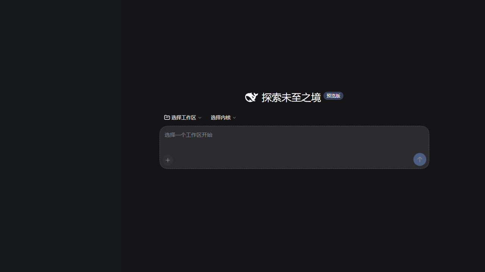
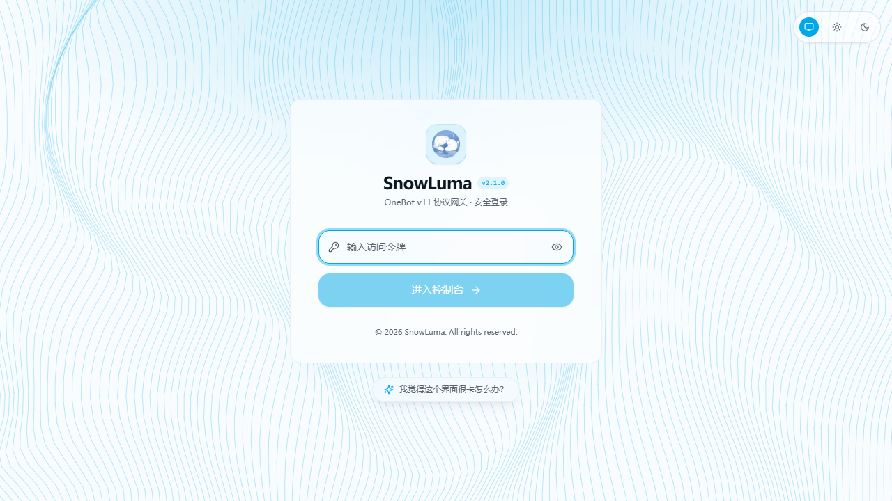
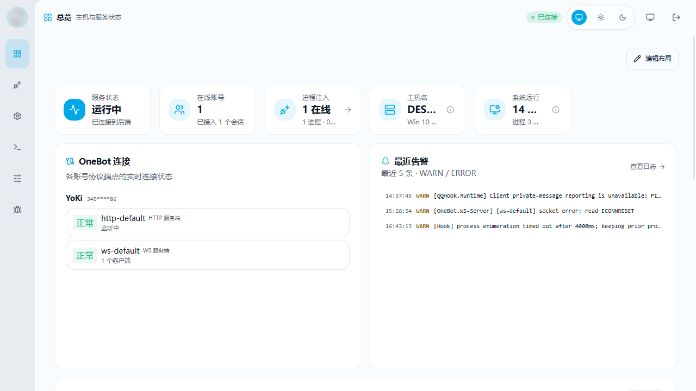
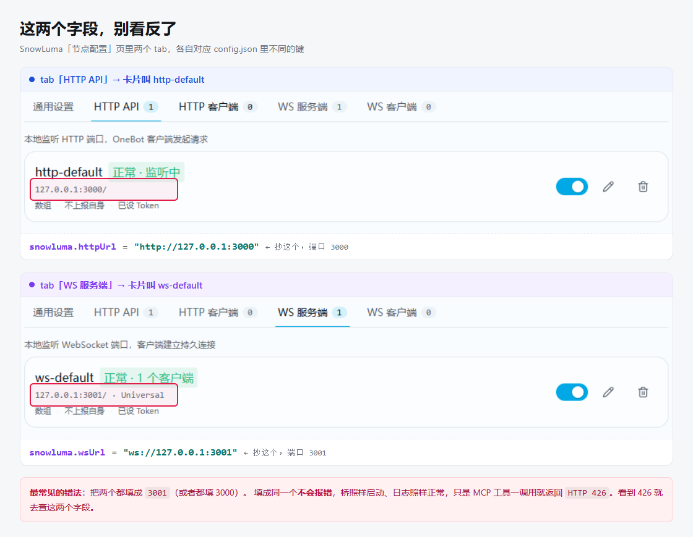
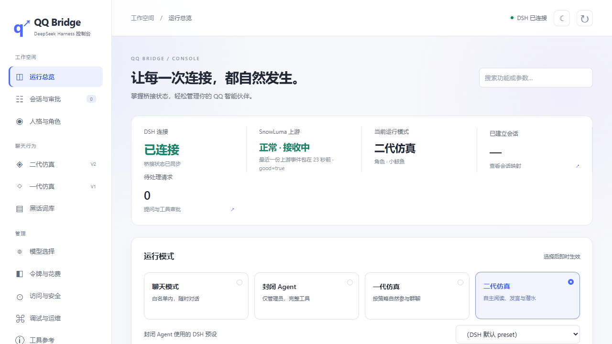

# 从一台干净的机器开始

> 这份文档回答一个问题：**我手上什么都没有，想把小鲸鱼记忆跑起来，要按什么顺序做？**
>
> 如果你已经有一个跑着的 `qq-bridge`，只想加记忆层 —— 别读这篇，去看 [DEPLOYMENT.md 第 4 节「一条命令装完」](DEPLOYMENT.md#一条命令装完懒人路线)。那一条命令就够了。
>
> 这篇讲的是「连 qq-bridge 都还没有」的情况。

---

## 目录

- [先看清楚：六步里哪一步能一键](#先看清楚六步里哪一步能一键)
- [准备工作：三个版本号，别搞错](#准备工作三个版本号别搞错)
- [第 1 步：DSH](#第-1-步dsh)
- [第 2 步：qq-bridge](#第-2-步qq-bridge)
- [第 3 步：给 DSH 装 preset 和 MCP](#第-3-步给-dsh-装-preset-和-mcp)
- [第 4 步：SnowLuma](#第-4-步snowluma)
- [第 5 步：向导 + 填 config.json](#第-5-步向导--填-configjson)
- [第 6 步：装记忆层（唯一一键的那步）](#第-6-步装记忆层唯一一键的那步)
- [第 7 步：启动，然后验证](#第-7-步启动然后验证)
- [出事了怎么办](#出事了怎么办)
- [每一步的失败信号对照表](#每一步的失败信号对照表)

---

## 先看清楚：六步里哪一步能一键

| 步骤 | 做什么 | 谁来做 |
| --- | --- | --- |
| 1 | 装并启动 DSH | 手动 |
| 2 | clone + `npm install` + 复制 config | 手动（三条命令） |
| 3 | `node scripts/setup-dsh.mjs` 然后**重启 DSH** | 手动（一条命令 + 一次重启） |
| 4 | 下载解压 SnowLuma，双击 `launcher.bat` | **必须手动**，见下方说明 |
| 5 | SnowLuma 向导扫码 + 填 `config.json` | 手动 |
| 6 | **装记忆层** | ✅ **一键** `node scripts/install-to-bridge.mjs --apply` |
| 7 | 启动 + 验证 | 手动（一条命令 + 一个 curl） |

第 6 步上还有一个小工具值一提：`node scripts/check-env.mjs` 把上面六步的结果全查一遍
（十三项只读检查），装之前跑一次，能提前发现「Node 版本不对」「白名单是空的」
「两个端口填成同一个」这类到后面才暴露的问题。

**为什么第 4 步不能自动化。** SnowLuma 是专有组件，它的 EULA 第 5.4 条明确写了：并入第三方安装包或 Docker 镜像、通过自动化脚本部署，都需要事先取得书面授权。qq-bridge 上游从 v0.1.5 起也主动移除了 `start_snowluma` / `stop_snowluma` 两个工具。所以任何「一键装完」的脚本都不该替你拉起 SnowLuma —— 包括我这个。下载 zip、解压、双击 `launcher.bat`、手机扫码，这四下手得你自己来。

---

## 准备工作：三个版本号，别搞错

三个项目对 Node 的要求**不一样**，装之前先看一眼：

| 项目 | 最低 Node | 备注 |
| --- | --- | --- |
| whale-memory（本项目） | **18** | `package.json` 里 `"node": ">=18"` |
| qq-bridge | **22.13** | `"node": ">=22.13.0"`，会在 `npm install` 时硬检查 |
| SnowLuma Lite 版 | 22.13 | 完整版自带 Node 运行时，不挑本机版本 |

**结论：装 qq-bridge 就意味着你至少要 Node 22.13。** 建议直接上 Node 22 LTS 或 24，用 `node -v` 确认。

另外准备三样东西：

- 一个**能登录的 QQ 号**（当机器人用，建议小号）
- 一个**能用的 DSH**（下一步装）
- 一个**模型配置**（DeepSeek 官方 key，或你自己在 DSH 里配好的 provider）

---

## 第 1 步：DSH

DSH（DeepSeek Harness）是整个链路的大脑。qq-bridge 本身不会说话，它把消息转给 DSH，DSH 里的人格和模型决定怎么回。

装好、启动，确认 `http://127.0.0.1:3080` 能打开。**先别关它，后面一直要用。**



看到这个界面 = DSH 活着。它自己不需要你做任何配置，等第 3 步往里装 preset。

验证：

```bash
curl -s -o /dev/null -w "%{http_code}\n" http://127.0.0.1:3080
```

返回 `200` 或 `302` 都算活着。连不上就别往下走，后面每一步都会因此报奇怪的错。

---

## 第 2 步：qq-bridge

```bash
git clone https://github.com/Derpyu520/qq-bridge.git
cd qq-bridge
npm install
```

`npm install` 会跑 postinstall，自动修补 `@snowluma/sdk` 的 ESM 打包 bug。看到类似这样的输出就对了：

```
[patch-snowluma] @snowluma/mcp: 修补了 1 个文件
[patch-snowluma] 合计 13 个文件
added 128 packages in 35s
```

然后复制配置模板：

```bash
# Windows CMD
copy config.example.json config.json
# PowerShell / bash
cp config.example.json config.json
```

**此刻的 `config.json` 是「不能工作」的状态**，两处空着：`allow.private` / `allow.groups` 是空数组，`snowluma` 段没填端口。空白名单 + `allowAllWhenEmpty: false` 时桥一条消息都不响应 —— 这是刻意的 fail-closed 默认值。第 5 步填。

---

## 第 3 步：给 DSH 装 preset 和 MCP

```bash
node scripts/setup-dsh.mjs
```

这个脚本做两件事：在 DSH 里装 `qq-chat` / `qq-chat-v2` 两个 agent preset，并挂载 qq-bridge 的 MCP 工具。

**装完必须重启 DSH。** preset 和 MCP 只在 DSH 启动时加载一次，不重启等于没装。

跳过这步桥不会崩，但表现和没装一样：群聊会话拿不到 `qq-chat-v2` preset，桥会**拒绝建会话**（这是有意的安全设计 —— 绝不悄悄回退到带 bash / 文件工具的默认 preset）。新手最容易在这里以为「代码有 bug」。

验证：重启 DSH 后，在 DSH 的设置里能看到 `qq-chat` / `qq-chat-v2`。

---

## 第 4 步：SnowLuma

去 <https://github.com/SnowLuma/SnowLuma/releases/latest> 下载 `SnowLuma-v<版本>-win-x64.zip`。

- **完整版**自带 Node 运行时，不挑本机版本
- **Lite 版**要求本机 Node ≥ 22.13

解压到任意目录（比如 `C:\SnowLuma`），**双击 `launcher.bat`**。第一次启动会打印一个 WebUI 地址和一个初始密码，第 5 步要用。

别关这个窗口。

---

## 第 5 步：向导 + 填 config.json

打开 SnowLuma 打印的 WebUI 地址（常见 `http://localhost:5099`，**以你启动日志里实际打印的为准**），第一眼是这个登录页：



**这个框填的是启动日志里那个初始密码**（不是 QQ 密码，也不是 accessToken）。进去之后可以在「系统设置」里改。

按向导走三件事：

1. 同意条款
2. 设置密码
3. 接入 QQ 进程 —— 这里会出二维码，**手机 QQ 扫码登录**

登录成功后进「节点配置」，你会看到这个界面 —— 左边选中刚登上的号，右边一排 tab：



要开两个服务，**两个端口不一样，这是后面 `config.json` 填错的第一大来源**。这两页长得几乎一样（同一页、只差 tab 高亮和端口），所以下面这张图是拼起来的对比 —— 上半张是 HTTP API，下半张是 WS 服务端，红框圈的就是要抄走的地址：



单独两页原图在这儿，想放大看细节：`docs/diagrams/screens/05-snowluma-onebot.png`（HTTP API，`http-default`，3000）和 `docs/diagrams/screens/06-snowluma-ws.png`（WS 服务端，`ws-default`，3001）。

| tab | 卡片名 | 端口 | 填到 config.json 的哪 |
| --- | --- | --- | --- |
| HTTP API | `http-default` | 3000 | `snowluma.httpUrl` |
| WS 服务端 | `ws-default` | 3001 | `snowluma.wsUrl` |

**两个填成同一个不会报错** —— 桥照样启动、日志照样正常，只有 MCP 工具一调用返回 `HTTP 426`。看到 426 就回来查这两行。

有 accessToken 就记下来（图里那个「已设 Token」的标记 = 这个端点开了鉴权）。

然后回到 `qq-bridge/config.json`，填两处：

```json
"snowluma": {
  "wsUrl": "ws://127.0.0.1:3001",
  "httpUrl": "http://127.0.0.1:3000",
  "accessToken": "WebUI 里配的 token，没配就留空"
},
"allow": {
  "private": [你的QQ号],
  "groups": [你的群号],
  "allowAllWhenEmpty": false
}
```

**两个坑，都有人踩过：**

- `wsUrl` 填 OneBot **WebSocket** 端口，`httpUrl` 填 OneBot **HTTP API** 端口。**别填成同一个 WS 端口**，否则 MCP 工具会报 `HTTP 426`。
- `allow.private` / `allow.groups` 里的号码是**数字**，不要加引号写成字符串。写错不会报错，只会静默不响应。

---

## 第 6 步：装记忆层（唯一一键的那步）

到这一步 qq-bridge 已经能收发消息了，但它还没有长期记忆 —— 每次对话都是失忆的。现在装记忆层。

### 先跑一次环境自检

```bash
node scripts/check-env.mjs
```

十三项只读检查，**不改任何文件**。装之前跑一遍能省掉后面一半的排错：Node 版本够不够、
桥认没认到、白名单填没填、DSH 和 SnowLuma 通不通、preset 在不在。每条不通过都直接给修复命令。

对有问题的项，你可以对照这份实测输出理解长什么样：

```
✅ Node 版本：24.20.0（qq-bridge 要 ≥22.13，够了）
✅ 找到 qq-bridge：C:\Apps\qq-bridge-hub\qq-bridge
⚠️  config.json：能解析，但文件带 UTF-8 BOM
     → 桥自己读时会去掉 BOM，但你自己写脚本解析时容易踩坑（JSON.parse 报 Unexpected token）。建议存成「UTF-8 无 BOM」。
✅ 白名单：1 个私聊 + 1 个群
✅ DSH 可达：http://127.0.0.1:3080 端口在听
✅ DSH 端 preset：agent-presets 与 state/mode.json 都在
✅ SnowLuma 端点：WS 3001 与 HTTP 3000 都在听
✅ SnowLuma 登录状态：已登录：<昵称>（<QQ号>）
⚠️  桥控制台端口：3100 已在监听 —— 桥正在跑（或端口被别的程序占了）
✅ 记忆层：11 个 memory-*.js，关键符号齐全
✅ 词表：基础词表就位，自学词 800 条

  没有阻塞项，但有 2 条提醒 —— 看一眼上面带 → 的说明。
```

退出码 `0` = 没有阻塞项（有 ⚠️ 也能继续），`1` = 有 ❌ 硬伤，先修再说。

### 再装

把 whale-memory clone 到 **qq-bridge 旁边**（同级目录）：

```bash
cd ..
git clone https://github.com/yokipeek/whale-memory.git
cd whale-memory
```

然后**先干跑**（默认就是干跑，只报告不动手）：

```bash
node scripts/install-to-bridge.mjs
```

你应该看到它自己找到了桥：

```
  源仓库：D:\project\whale-memory
  目标桥：C:\Apps\qq-bridge-hub\qq-bridge
  模式：干跑（只报告，加 --apply 才动手）
══════════════════════════════════════════════════════════
  找到桥：C:\Apps\qq-bridge-hub\qq-bridge
```

认对了就真装：

```bash
node scripts/install-to-bridge.mjs --apply
```

它做四件事：

1. 拷 10 个 `src/memory-*.js` 进桥的 `src/`
2. 拷词表 `data/jieba-dict.txt` + `jieba-freq.txt`（已存在且内容一致就跳过）
3. 给 `src/bridge.js` 打 9 处补丁（import、记忆实例、收消息记流水、发消息记流水、注入提示词、6 个 HTTP 路由、配置默认值）
4. 给 `src/mcp-snowluma-safe.js` 加 4 个工具（`qq_memory_recall` / `remember` / `forget` / `stats`）

**三个保证：**

| 保证 | 怎么做到的 |
| --- | --- |
| 幂等 | 每处补丁都有一个「探针字符串」。文件里已经有这行就跳过，所以可以反复跑 |
| 抗上游升级 | 用语义锚点（比如完整的那行 `const base = roleLine + ...`）定位，不用行号。上游挪了行不影响 |
| 可回滚 | 改之前备份成 `bridge.js.memory-install.bak-<时间戳>`，写完跑 `node --check`，语法错自动还原 |

**不覆盖你的东西**：`data/jieba-learned.txt`（你自己训出来的词表）如果已经存在，一律不动。

认不到桥怎么办？它会把你试过的所有路径列出来。三种指定方式任选：

```bash
# ① 直接给路径
node scripts/install-to-bridge.mjs --bridge C:\Apps\qq-bridge-hub\qq-bridge --apply

# ② 环境变量（PowerShell）
$env:QQ_BRIDGE_DIR="C:\Apps\qq-bridge-hub\qq-bridge"; node scripts/install-to-bridge.mjs --apply

# ③ 环境变量（bash）
QQ_BRIDGE_DIR=/c/Apps/qq-bridge-hub/qq-bridge node scripts/install-to-bridge.mjs --apply
```

---

## 第 7 步：启动，然后验证

先确认桥没在跑（有单实例锁，重复启动会被拒），然后：

```bash
npm start
```

Windows 想让它崩溃自动重启就用 `start.bat`（守护模式，`start.bat` 是 `:loop` 无限重启的，关窗口才停）。

启动日志里应该有这么几行：

```
[bridge] [memory] 记忆整理循环已启动（每 30 分钟一轮）
[bridge] DSH 已就绪（模式: reserved2）
[bridge] 本地控制台已启动：http://127.0.0.1:3100
[bridge] SnowLuma 已连接：ws://127.0.0.1:3001
```

**第一行 `[memory] 记忆整理循环已启动` 出现 = 记忆层活着。** 没有这行，说明补丁没落或者 `config.json` 里 `socialV2.memory.enabled` 被设成了 false。

打开控制台 `http://127.0.0.1:3100/?token=<consoleToken>`，四张指标卡全绿就对了：



**这张图里最该盯的是第二格「SnowLuma 上游」。** 显示「未连接 · 连不上 QQ 网关，请先启动 SnowLuma」= 第 4 步没做对（SnowLuma 没开，或 `wsUrl` 端口不对）。这时候桥能跑、记忆层也在跑，但一条消息都收不到。

然后验证记忆 HTTP 端点。先拿到 consoleToken（在 `config.json` 里，或控制台页面能看到）：

```bash
curl -s -H "x-console-token: 你的token" \
  http://127.0.0.1:3100/api/socialV2/memory-stats
```

返回 `"ok": true` 且带 `"semantic": 0`、`"episodicDays": 0` 就是装好了（全新库，数字当然是 0）。

再测一次写入和读取 —— **用 node，不要用 Git Bash 的 curl**：

```js
// test-memory.mjs
const base = 'http://127.0.0.1:3100';
const H = { 'x-console-token': '你的token', 'Content-Type': 'application/json' };
const post = (p, b) => fetch(base + p, { method: 'POST', headers: H, body: JSON.stringify(b) }).then(r => r.json());
const get = (p) => fetch(base + p, { headers: H }).then(r => r.json());

console.log(await post('/api/socialV2/memory-remember', {
  key: 'group:你的群号',
  text: '他不抽烟，喜欢蓝色小鲸鱼',
  layer: 'long',
  importance: 4,
}));

const r = await get('/api/socialV2/memory-recall?q=' + encodeURIComponent('他喜欢什么') + '&limit=3');
console.log('matched:', r.matched);
console.log('text:', r.text);
```

期望输出：

```
{ ok: true, key: 'group:...', remembered: { id: '...', text: '他不抽烟，喜欢蓝色小鲸鱼', layer: 'long', importance: 4 } }
matched: 1
text: 【你想起来的事】
- 2026-10-29@group:... 某人：他不抽烟，喜欢蓝色小鲸鱼
```

看到返回里带日期和出处（`@group:... 某人`），就说明整条链路通了。

**为什么会踩到 curl 的坑**：Git Bash 的 `curl -d` 会把中文字符按 GBK 编码送出去，桥按 UTF-8 解，存进库就是 `�������̣�ϲ����ɫС����`。用 node 的 `fetch` 就没这个问题。控制台面板也不会，它自己走 JSON。

---

## 出事了怎么办

### 启动就崩 / 端口被占

桥有单实例锁。先按 PID 精确杀，**不要用 `taskkill /IM node.exe`**（会连带杀掉 DSH 和其他 node 进程）：

```bash
# 找到真实 PID
netstat -ano | grep ":3100.*LISTENING"
# 按 PID 杀
taskkill /F /PID <上面查到的PID>
# 清锁
rm -f state/bridge.lock
```

如果启动时看到 `EADDRINUSE 127.0.0.1:3100`，说明**旧实例还在**。这种情况下新进程会启动失败但旧进程继续响应，你会以为「改了代码没生效」，其实跑的是旧的。查 PID 再杀。

### 用 start.bat 起的，杀不干净

`start.bat` 是 `:loop` 无限重启的。**先杀守卫 cmd，再杀 node**，顺序反了会立刻被重拉：

```powershell
# 先找 cmd.exe /c start.bat 的 PID
Get-CimInstance Win32_Process -Filter "Name='cmd.exe'" | Select ProcessId, CommandLine
# 杀守卫
taskkill /F /PID <守卫cmd的PID>
# 再杀 node
taskkill /F /PID <bridge的PID>
```

### `[memory] 记忆整理循环已启动` 没出现

按这个顺序查：

1. `src/bridge.js` 里 `grep -c "\[memory\]"` 是不是 9（九处补丁都落了）
2. `node --check src/bridge.js` 过不过
3. `config.json` 里 `socialV2.memory.enabled` 是不是被写成了 `false`
4. `config.json` 是不是带 BOM —— **这个真的会炸**。用 node 读：

```js
const raw = require('fs').readFileSync('config.json', 'utf8');
JSON.parse(raw.replace(/^\uFEFF/, ''));  // 必须去掉 BOM
```

带 BOM 时直接 `JSON.parse` 会报 `SyntaxError: Unexpected token ''`，而那个字符肉眼看不见。

### 桥启动了但 QQ 上没反应

九成是这三件事之一：

| 现象 | 原因 |
| --- | --- |
| 日志有「白名单为空且 allowAllWhenEmpty=false」 | `config.json` 的 `allow.private` / `allow.groups` 没填 |
| 日志反复「SnowLuma 连接断开 code=1006」 | SnowLuma 没启动，或 `wsUrl` 端口填错 |
| 收得到消息但 AI 不回 | 第 3 步 `setup-dsh.mjs` 没跑，或跑了没重启 DSH |

MCP 工具报 `HTTP 426` = 你把 `httpUrl` 填成了 WS 端口。

### 记忆检索一直返回空

全新库返回空是**正常的**，得先聊几轮。如果聊了很久还是空：

1. `memory-stats` 里 `semantic` 是不是 0（是的话根本没写进去）
2. `who` 是不是严格字符串不匹配 —— 桥里 `who` 用的是 `msg.sender`（QQ 昵称）。改过昵称的老记忆就查不到了
3. 词表切不开你的词 —— 跑 `node scripts/check-lexicon.mjs`，或者 `node scripts/learn-lexicon.mjs --apply` 让它从你的聊天记录里学新词

更详细的排错看 [DEPLOYMENT.md 第 8 节「排错手册」](DEPLOYMENT.md#8-排错手册)。

---

## 每一步的失败信号对照表

装的时候对照这张表，出问题立刻知道卡在哪：

| 你在哪一步 | 出错时你会看到 | 意思 |
| --- | --- | --- |
| 第 1 步 | `curl http://127.0.0.1:3080` 连不上 | DSH 没起来，后面全都白搭 |
| 第 2 步 | `npm install` 报 engines 错 | Node < 22.13，升级 Node |
| 第 2 步 | postinstall 没打印 `[patch-snowluma]` | 依赖没装全，删 `node_modules` 重来 |
| 第 3 步 | 重启 DSH 后设置里没有 `qq-chat` | 脚本没跑或跑失败，看 `setup-dsh.mjs` 输出 |
| 第 4 步 | `launcher.bat` 闪一下就关 | 完整版没解压全，或杀软拦了 |
| 第 5 步 | 扫码后 SnowLuma 显示未登录 | 手机 QQ 没确认，或账号风控 |
| 第 6 步 | `报「不像一个 qq-bridge」` | 路径没认对，用 `--bridge` 手动指定 |
| 第 6 步 | `有 N 处没落下去` | 上游改了代码，锚点失配，看提示搜相近代码改 `find` |
| 第 7 步 | 日志没有 `[memory]` 那行 | 补丁没落，或 `memory.enabled: false` |
| 第 7 步 | `memory-stats` 返回 401 | consoleToken 不对或没带 header |
| 第 7 步 | 存储的中文是乱码 | 用了 Git Bash 的 `curl -d`，换 node fetch |

---

## 装完之后

记忆层在跑了，但它需要时间攒东西。头几天你会觉得「它好像什么都没记住」—— 正常。原因：

- **衰减**：新记忆每天按幂律掉权重，一天没被提起就往下沉
- **巩固**：`memoryTick` 每 30 分钟跑一轮，把白天的流水整理成事实。第一轮通常要等到当天结束
- **词表冷启动**：你的私房词（昵称、梗、项目名）一开始不在词表里，切不开就检索不到

**建议第一周做两件事：**

1. 正常聊天，别刻意喂它东西 —— 真实对话比测试数据有价值
2. 一周后跑 `node scripts/learn-lexicon.mjs`（先干跑看看挖出什么词），觉得对就 `--apply`

想理解它内部怎么想的，回去看 [README.md](README.md)。想调参数、接别的平台、做备份搬家，看 [DEPLOYMENT.md](DEPLOYMENT.md)。
