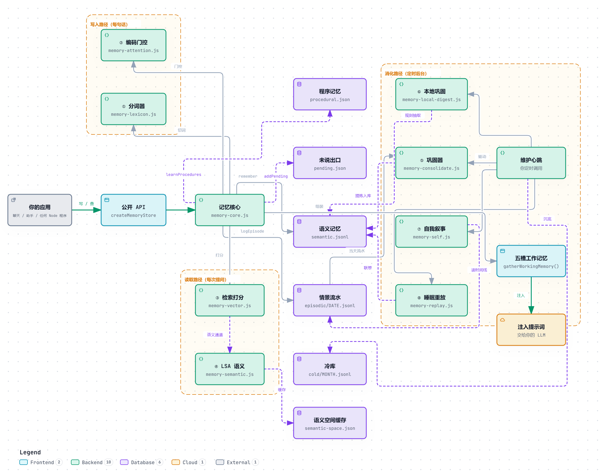

# 🐋 Whale Memory

**一个会淡忘、能联想、并且真的记得住"这个人是谁"的长期记忆系统。**

零依赖 · 纯本地 · 中文优先 · Node.js

[](LICENSE)
[](package.json)
[](package.json)
[](tests/core.test.mjs)
[](docs/ARCHITECTURE.md)

```
你的机器人聊完就忘？
上下文一压缩，前面的事就没了？
塞进向量库，噪声越来越多，还说不清"她为什么想起这件事"？
```

Whale Memory 用一套能解释、能调试、能自己长出词表的机制解决这件事。它不调任何云端服务，不加一个依赖，一份记忆就是几个 JSON 文件——你随时能打开看。

---

## 目录

- [它到底解决什么问题](#它到底解决什么问题)
- [给完全不懂技术的你：它怎么工作](#给完全不懂技术的你它怎么工作)
- [30 秒上手](#30-秒上手)
- [系统结构](#系统结构)
- [核心机制（技术版）](#核心机制技术版)
- [API](#api)
- [和别的记忆方案有什么不同](#和别的记忆方案有什么不同)
- [已知边界](#已知边界)
- [项目故事：这些数字是怎么来的](#项目故事这些数字是怎么来的)
- [参与贡献](#参与贡献)

---

## 它到底解决什么问题

普通的做法有两种，都有硬伤：

| 做法 | 硬伤 |
|---|---|
| **只靠上下文窗口** | 隔一天就失忆。压缩一次，前面的事全淡了。 |
| **全塞进向量库** | 噪声越来越大；检索越来越慢；说不清"为什么想起这件事"；而且**永远不会忘**，三年前的流水和昨天的事同等重要。 |

Whale Memory 走第三条路：**有结构地记，有梯度地忘，有理由地想起来。**

四条设计原则：

1. **写的时候分层**——流水是流水，事实是事实，约定是约定，不能一锅粥。
2. **取的时候混合打分**——字面、语义、重要度、新鲜度一起算，不是一个余弦相似度完事。
3. **忘的时候有梯度**——衰减 → 降层 → 沉冷库，不是"全留"或"全删"两个极端。
4. **每一步都能解释**——`recall()` 返回的每一条都带 `evidence` / `score` / `why`，你能查出"她为什么想起这个"。

---

## 给完全不懂技术的你：它怎么工作

> 这一节不出现任何技术词。如果你只想知道它是怎么想的，读这里就够了。

### 想象她有一个房间

房间里摆着几个柜子。你每说一句话，她做四件事。

### 第一步：听懂你在说什么

她得先把你的话**拆成一个个词**——像把一串珠子拆成单颗。

拆的时候要用字典。**这一步比你想的重要**：如果字典里没有"大肥鱼"这个词，她看到这三个字只能看见「大」「肥」「鱼」三块碎砖，一个意思都拼不出来。你问"大肥鱼是什么"，她拿着三块碎砖去翻柜子，一块都对不上，于是**一条都想不起来**。

所以这个系统带了一个功能：**让她自己读你俩的全部聊天记录，把你们常用的私房词挑出来，编成她自己的小词典。**
「大肥鱼」「小鲸鱼」这种词，只要你们说过几次，她自己就会认了。

### 第二步：判断值不值得记

不是每句话都值得记。"在吗""哈哈""嗯嗯"直接扔掉。

有内容的话，她掂一下有多重：
- 「今天天气不错」——很轻
- 「我答应过以后你想说什么直接说」——很重，这是约定
- 「我熬夜到三点，在给你做记忆系统」——重，还带情绪

### 第三步：放进对应的柜子

| 柜子 | 放什么 | 打个比方 |
|---|---|---|
| **流水本** | 原始对话，按天一本 | 日记。一年 365 本 |
| **重点本** | 提炼过的事实 | 从日记里抄出来的"他喜欢什么/讨厌什么"速查表 |
| **便签纸** | 想说但没说出口的话 | 贴在冰箱上，过几天自动掉 |
| **菜谱本** | 学会的做法 | 「发语音要先合成再发」这种步骤 |
| **地下室** | 沉底的老记忆 | 不扔，搬下去。想找还能爬下去翻 |

### 第四步：你问她事，她怎么想起来

你问"你还记得我熬夜的事吗"，她做三件事：

**1. 从你的问题里挑出真正的线索**

「熬夜」留下；「你」「记得」「吗」扔掉——这些词什么都没指。

这里有个讲究，叫**双尺子**：

- 第一把尺：这个词**在她自己的记忆里**稀不稀有？「熬夜」在她日记里只出现几次，是好线索。
- 第二把尺：光在自己记忆里稀有**不够**。「表示」这个词在她日记里也只出现两次，可它在中文里满大街都是，那它就不是线索。

两道都过关，才拿它去翻柜子。

**2. 用三种找法一起找**

- **按字面找**：谁写过「熬夜」两个字
- **按意思找**：她读过自己所有日记，学会了「熬夜」和「通宵」意思挨得近。所以你没说「熬夜」，说「通宵」，她也找得到
- **按分量找**：越重要、越近的事排越前面

**3. 摊在桌上——但宁可少摊，也不硬凑**

最多摊 5 页。如果只有 1 页真的相关，就只摊 1 页。

> 摊一页不相干的，比只摊一页对的更糟。这会让她说出"你上次不是说……"然后说错。

### 第五步：她怎么"忘"

**她不删东西。** 她只是让老的越来越难翻到。

- 刚发生的事 → 翻一次就找到
- 三天前的 → 得多翻两下
- 三个月前的 → 你得提得很准
- 三年前的 → 得她自己都差不多忘了，你一提醒才「模糊想起来」

**但永远翻得到。**

这跟硬盘不一样。硬盘是「有」或「没有」；她是「清楚」或「模糊」。

所以「初恋」和「上周三吃的面」不会在一年后同时消失——前者还是一提就有感觉，后者得使劲想。这就是为什么这里的衰减曲线是**幂律**而不是指数曲线。

### 第六步：她"睡觉"的时候在干什么

每隔半小时，她会做一次整理（你写个定时器调用一下就行）：

1. 翻今天新写的流水本，把值得记一辈子的抄进重点本
2. 把重复的擦掉——同一件事写了三遍，并成一条
3. 算旧账：重要度重新称一遍，跌太多的搬进地下室
4. **最神的一步**：把散在好几天里的碎片打乱重新拼

第 4 步举个例子：

> 24 号你说「我赢了你也该高兴」。
> 27 号你说「有你这进度播报我半点儿不用慌」。
>
> 这两句隔了三天，当时都不起眼。她在「睡觉」时把它们拼到一起，想通了：
> **他要的不是甜话，是有人替他盯着、替他稳住。**

这条想通的事会单独放进一个抽屉，叫「我自己琢磨的」——**跟你说的原话分开摆**，免得她把自己的推测当成你说过的话。

---

## 30 秒上手

```bash
npm install whale-memory
```

或者直接复制 `src/` 目录进你的项目——**它没有任何依赖**，只用 Node 内置模块。

```js
import { createMemoryStore } from 'whale-memory';

const mem = createMemoryStore({ dir: './my-memory' });

// 记流水（谁在哪天说了什么）
mem.logEpisode({ who: '他', text: '今天又熬夜到三点', at: Date.now() });

// 记事实（要记久一点的）
mem.remember('他不抽烟；喜欢蓝色小鲸鱼', {
  kind: 'semantic',
  layer: 'long',
  who: '他',
  importance: 4,
});

// 提问
const hits = mem.recall('他抽烟吗', { limit: 3 });
// → [{ id, text, evidence: 0.34, score: 0.70, confidence, confidenceLabel, ... }]
```

跑一遍完整示例：

```bash
npm run demo
```

它会建一个临时记忆库、记几件事、问四个问题、然后清理。输出长这样：

```
问：「他还熬夜吗」
  [证据 0.650 · 得分 0.734] 今天又熬夜到三点，说在给我做记忆系统

问：「外面天气怎么样」
  → 一条都没想起来（这本身也是正确行为——没证据就不要硬凑）
```

---

## 系统结构



> 可交互版（可缩放、深色/浅色、导出 PNG/SVG）：[docs/diagrams/whale-memory-architecture.html](docs/diagrams/whale-memory-architecture.html)

三条路径，共用同一份存储：

| 路径 | 什么时候跑 | 干什么 |
|---|---|---|
| **写入** | 每收到一句话 | 切词 → 判断值不值得记 → 落盘 |
| **读取** | 每次要回答 | 挑线索 → 三路打分 → 装进工作记忆 |
| **消化** | 定时（建议 30 分钟） | 巩固 → 合并 → 衰减 → 重放 |

---

## 核心机制（技术版）

### 1. 中文分词：为什么必须用词表

字符 n-gram 是最省事的做法，但它有一个致命问题：

```
「你还记得我答应过什么吗」
  n-gram 切法 → 你还 / 还记 / 记得 / 得我 / 我答 / 答应 / 应过 / 过什 / 什么
                 ↑ 一半是跨词碎片
```

这些碎片（「还记」「得我」）在语料里天生罕见，于是被当成**稀有线索**给了高分。这就是"五个弱证据攒起来，看着像强证据"。

Whale Memory 用 jieba 的 10.9 万词表做最长匹配：

```
「你还记得我答应过什么吗」
  词表切法 → 记得 / 答应 / 过 / 什么
```

**关键细节：一个字都不丢。** 兜底单字是必须的——老切法会把「她的胃」丢成「胃不好」，于是查「她的胃」只剩单字「胃」，而记忆那边切出「胃不」，按词比根本对不上。

### 2. 词表自学习：让系统认识你的私房词

通用词表不认识「大肥鱼」「小鲸鱼」这种你们自己长出来的词。最长匹配切下去会变成单字：

```
大肥鱼 → 大 | 肥 | 鱼      （三个都是常用字，全被判成"不算线索"）
```

调阈值救不回来——**这是切词错了，不是打分错了**。

所以带了一个新词发现器（`scripts/learn-lexicon.mjs`），跑在你自己的语料上：

| 条件 | 判据 | 为什么 |
|---|---|---|
| ① 见得够多 | 频次 ≥ 3 | 只出现一两次的当噪声 |
| ② 老在一起 | PMI ≥ 4.0 | 这几个字总是黏在一起，不是偶然共现 |
| ③ 前后能接别的字 | 左右邻熵 ≥ 0.9 | 说明它是完整单位 |

第 ③ 条是关键：

```
「大肥鱼」  左边接过 是/叫/这/…  右熵也高  → 真词 ✓
「肥鱼」    左边永远只接「大」   左熵 0    → 只是「大肥鱼」的尾巴 ✗
```

熵高 = 邻居杂乱 = 真词；熵低 = 邻居固定 = 某词的一部分。这条能自动去掉被长词包住的尾段。

挖出来的词写到 `data/jieba-learned.txt`，跟通用词表**合并**读取。原词表不动，删掉学习文件就回到纯通用词表。

### 3. 检索打分：证据和排序必须分开

这是这个系统最重要的一个设计决定。

```
❌ 错误做法：门槛卡总分
   score = 字面×0.34 + 语义×0.36 + 记忆分×0.30
   if (score < 0.3) 丢掉

   后果：记忆分（重要度/衰减）一动，整库分数整体平移，
        连着"该想起的"一起被挡掉。
```

实测数据：把「没写时间戳算多鲜活」这个旋钮从 1 调到 0.75，该想起的从 10/11 掉到 8/11——而它们本来就拿同一个值，压低**不改变排序**，纯白损失。

```
✓ 正确做法：门槛卡证据，排序用总分
   evidence = 命中词的稀有度之和，过饱和曲线 s/(s+K)
   if (evidence < gate) 丢掉          ← 只管"有没有真关系"
   score    = 三路融合                ← 只管"排第几"
```

稀有度是**双尺子**：

```js
稀有度 = 库内稀有度 × 通用中文稀有度 × 单字降权

库内稀有度  = log((N+1)/(df+1)) / log(N+1)     // 对数式，小库不崩
通用稀有度  = jieba 词频 / 99                   // 0=最常用, 99=最具体
单字降权    = 0.35                              // 中文语义单位基本 ≥2 字
```

**为什么必须用对数式而不是 `1 - df/N`：**

3 条记忆时，某词出现 1 次 → `1 - 1/(3×0.25) = -0.33` → 归零 → **唯一那条该命中的记忆 evidence = 0，整轮一条都给不出来**。
对数式在小库上是 0.5，正常给分。

### 4. 三路融合

```js
score = 字面 × 0.34 + 语义 × 0.36 + 记忆分 × 0.30

字面  = BM25 归一化（谁写过这些词）
语义  = LSA 语义空间 × 0.62 + n-gram 余弦 × 0.38
记忆分 = 重要度 × 幂律衰减 × 命中次数
```

**为什么语义要两路：**

- 只有 n-gram：「给我发语音」能命中含「语音」的句子，但「最理想的声音」命中不了——字面一个桶都不重合
- 只有 LSA：语料少时短句向量会被拉平成「都差不多」，精确人名/型号反而变模糊
- 两路加权后各治对方的病：LSA 抓同义改述，n-gram 抓精确串

LSA 语义空间是**从她自己的语料里学出来的**（PMI 加权共现矩阵 + 随机化 SVD），不是预训练模型。好处是零依赖、可迁移、完全可解释——能反查是哪些共享上下文把两个词拉近的，黑盒 embedding 给不出这个。

### 5. 幂律衰减

```
recency = (1 + age_days)^(-alpha)

      alpha:   core → 0（永不衰减）
               long → 0.35（半衰期约 180 天）
            working → 0.90（半衰期约 21 天）
```

**为什么不是指数半衰期：**

指数衰减意味着「180 天的东西一定比 179 天的旧一半」。人不是这样。

Anderson & Schooler 在新闻标题的记忆实验里测出的是幂律：
`记住概率 ≈ 频率^a × 新近度^-b`

幂律的**尾巴特别长**——一年前的事还记得一点，十年后也还有点，而不是几年后精确等于 0。

指数衰减会让「初恋」和「上周三吃的面」在一年后同归于尽。这在陪伴场景里是致命的。

实测（`tests/core.test.mjs`）：

```js
scoreMemory(365 天前) > scoreMemory(3650 天前) > 0
```

### 6. 合并重复

语义层是只增不合并的。同一件事换个说法写两遍，就会出现两条。

不合并的代价**不是占空间**，是 top-k 被同一件事的 N 个变体占满，别的记忆挤不进注入窗口。

```js
textSimilarity(a, b) = |bigram(a) ∩ bigram(b)| / min(|bigram(a)|, |bigram(b)|)
```

**分母是 min 而不是并集**，这是刻意的：要抓的是「A 是 B 的片段」这种情况。

实测数据里 5 对重复全是这个形态：

```
「，我口头答应了名分」                        ← 被单独存成了尾巴
「要我叫他丈夫/让我做妻子，我口头答应了名分」  ← 完整那句
```

除以并集会被长度差稀释到 0.6 以下，永远够不到阈值。

阈值 0.95：0.92 时开始把「同一天的两件不同的事」并成一条，那是不可逆的信息损失。

### 7. 睡眠重放

把散在好几天里的碎片打乱重新拼，找「当时没注意到的联系」。

找到的联想写进 `kind: 'insight'`，并且在 `gatherWorkingMemory` 里**单独占一槽**。

为什么要单独占槽：实测重放产出的联想分数（0.44）永远打不过同话题原话（0.64/0.63），`relevantSlots=2` 时它一次都进不去——**机制造出来了却从不浮现，等于没做**。

---

## API

### `createMemoryStore({ dir, log?, now?, bm25CacheMs? })`

| 参数 | 默认 | 说明 |
|---|---|---|
| `dir` | 必填 | 记忆库目录 |
| `log` | `() => {}` | 日志回调 |
| `now` | `Date.now` | 时间源（测试可注入） |
| `bm25CacheMs` | 15000 | BM25 索引缓存时长 |

返回一个 store 对象，下面所有方法都在它上面。

### 写入

| 方法 | 用途 |
|---|---|
| `remember(text, opts)` | 记一条语义记忆。同层同 who 且文本完全一致会合并（importance 取大、hits+1） |
| `logEpisode({ who, text, at, ... })` | 记一条情景流水，按天落盘 |
| `addPending(text, { who, expiresInMs })` | 记「想说但没说出口的一句」，会过期 |
| `learnProcedures(text, { who })` | 学一个做法 |
| `setProfile(who, text, { importance, tags })` | 写某个人的画像 |

`remember` 的选项：

```js
{
  kind = 'semantic',        // episodic | semantic | pending | core | profile
  layer = null,             // core | long | working（不填按 kind 推断）
  who = '',                 // 这条记忆关于谁（会清掉零宽字符）
  where = '',               // 在哪发生的
  tags = [],
  importance = null,        // 1~5
  at = null,                // 时间戳
  source = 'ai',            // 来源标记
  attr = '',                // 属性键，用于同属性冲突检测
  derivedFrom = null,       // 溯源（哪些原始消息推出来的）
}
```

### 读取

| 方法 | 用途 |
|---|---|
| `recall(query, opts)` | 检索 top-k |
| `gatherWorkingMemory(query, opts)` | 组装五槽工作记忆 |
| `tipOfTongue(query)` | 「话在嘴边」——有痕迹但提不出来 |
| `searchCold(query)` | 从冷库往回捞 |
| `stats()` | 统计 |

`recall` 的选项：

```js
{
  limit = 8,
  who = '',                  // 只看这个人的（core 永远可见）
  layers = null,             // 只看某几层
  includeEpisodic = true,
  episodicDays = 14,         // 只看最近几天流水
  minScore = 0.01,           // 总分第二道门槛
  evidenceGate = 0.15,       // 证据门槛。0 = 关闭
  evidenceBucket = false,    // 是否按最高证据限制本趟条数
  currentMood = null,        // 当前心情（影响想起什么）
  dedupe = true,             // 干扰竞争压分
}
```

每条结果都带：

```js
{
  id, text, kind, layer, who,
  evidence,          // 证据量 0~1（"这条跟问题有没有真关系"）
  score,             // 最终得分（含重要度/新鲜度，决定排第几）
  bm25, semantic, memScore,   // 三路各自的原始分
  confidence, confidenceLabel, // very-fuzzy | fuzzy | glimpse | clear
  hits,
}
```

`confidence` 的用途：模型拿到 `fuzzy` 才敢说「我记不太清」，而不是把弱匹配当事实说出来。

### 维护

| 方法 | 用途 |
|---|---|
| `decay({ coldThreshold })` | 衰减 + 把跌到阈值的沉进冷库 |
| `mergeDuplicates({ threshold, dryRun })` | 合并重复 |
| `markConsolidated(day)` | 推进巩固水位 |
| `forget(id)` | 真删一条 |
| `patchItem(id, patch)` | 改一条（text / importance / tags / who / where） |
| `reviseFact(id, newText, { reason })` | 改写一条事实（保留历史） |

### 定时任务示例

```js
setInterval(() => {
  mem.decay({ coldThreshold: 0.06 });
  mem.mergeDuplicates({ threshold: 0.95 });
  // 巩固 / 重放 / 自我叙事按需调（可能需要你的 LLM）
}, 30 * 60 * 1000);
```

---

## 和别的记忆方案有什么不同

| | 上下文窗口 | 纯向量库 | Whale Memory |
|---|---|---|---|
| 跨会话 | ✗ | ✓ | ✓ |
| 会遗忘 | 整体丢失 | ✗ 只增不减 | ✓ 幂律 + 分层 + 冷库 |
| 能解释"为什么想起" | — | ✗ 一个余弦值 | ✓ evidence / score / 三路分 |
| 中文分词 | — | 常被忽略 | ✓ jieba 词表 + 自学习 |
| 认识你的私房词 | — | ✗ | ✓ 从你的语料挖 |
| 学出来的做法 | ✗ | ✗ | ✓ 程序记忆 |
| 自我叙事 | ✗ | ✗ | ✓ 时间线 / 里程碑 / 自传摘要 |
| 零依赖 | ✓ | ✗ | ✓ |
| 数据可读 | — | ✗ 二进制 | ✓ 就是 JSON |

---

## 已知边界

诚实列出来，别踩坑：

1. **不是开箱即用的聊天插件。** 这是一个库，你得自己接进你的应用。
2. **巩固和重放需要你的 LLM。** 本地规则巩固（`memory-local-digest`）零成本，但"提炼成一句第一人称的事实"要模型。不接也可以，只是语义层会长得慢。
3. **词表自学习需要语料。** 语料少于几万字时挖不出东西（统计不显著）。这时用通用词表也能跑。
4. **不是多租户设计。** 一个 store 一个目录。要隔离不同用户，给不同目录。
5. **并发写入不保证。** 同一目录被两个进程同时写会互相覆盖。请让一个进程独占。
6. **LSA 语义空间需要 ≥60 篇文档**才启用，否则自动退回 n-gram。
7. **`evidenceGate` 的默认值是按中文长句语料调的（0.15）。** 如果你的语料是英文短句，建议从 0.3 开始试——别照抄。

---

## 项目故事：这些数字是怎么来的

这个项目里每一个魔数背后都有一次实测。说明几个，好让你调参时知道自己在动什么。

### 教训一：不要照抄别人的阈值

这套机制最初是从一个同类项目移植的，对方用 0.30 作证据门槛。

照抄过来，18 条真实问法只有 61% 命中——**比不改还差**。

原因：对方的数据是短句为主，s 大；我们的数据是长句为主，一条记忆命中 2~3 个词，s 小，C 整体偏低。同一个数字搬到不同分布上就是错的。

**最后定成 0.15，并且改成可配参数。**

### 教训二：我从 11 条自造样例里调出了过拟合

发现有问题后，我开始一条一条改阈值。改一处、坏一处，来回折腾。

最后 18 条真实问法只剩 61%、2 轮一条都给不出来。

这是典型的过拟合：参数被调成"只对那 11 条测试题好看"。

**后来把改动拆成独立开关，一组一组量，并且留了一套从没参与调参的 15 条，才发现有两个改动是亏的：**

| 改动 | 结论 |
|---|---|
| 词表分词 | 真赚 |
| 词表自学习 | 真赚 |
| 证据门槛 | 有赚有亏，设成温和默认值 |
| 「不硬凑」分档上限 | **在这个库上是亏的**，默认关闭 |

### 教训三：零宽空格让 11% 的记忆静默失联

用户的昵称从别处复制过来，常带零宽字符 U+200B。

于是 `'Pure White'` 和 `'Pure\u200b White'` 在 JS 里不相等，而 `recall` 的 who 过滤是严格相等——**那批记忆一条都检索不到**。

实测：237 条里 26 条（11%）就这样失联了。

现在 `remember()` 写入侧会清掉所有零宽字符。清洗放在**写入侧**而不是检索侧：检索侧每轮都要跑，而且清不干净存量。

### 教训四：门槛差点把「想通了的事」挡死

`insight` 是重放产出的跨天联想，比如「他能叫你老婆大人，却翻脸不让你这么叫」。

这种话跟你当前问的话**字面上本来就不该对得上**，可它恰恰是最该想起来的。

证据门槛差点把它全挡掉 → `insight` 槽永远是空的。

修法：`gatherWorkingMemory` 调 `recall` 时传 `evidenceGate: 0`。因为**「想起来」和「找字面」本来就是两件事**——门槛是给「注入 k 条省 token」用的，工作记忆是固定几个槽，不需要靠它省。

---

## 跑测试

```bash
npm test
```

13 个测试，覆盖分词、双尺子稀有度、零宽清洗、重复合并、幂律衰减、工作记忆五槽。

不需要任何依赖，`node --test` 就够。

---

## 参与贡献

先读 [CONTRIBUTING.md](CONTRIBUTING.md) 的三条硬规矩：

1. 改动必须能单独关掉
2. 阈值必须带出处
3. 改打分逻辑必须附两组数据（调参集 + **没参与过调参**的泛化集）

第 3 条来自这个项目最惨的一次事故——详见上面的[项目故事](#教训二我从-11-条自造样例里调出了过拟合)。

改代码前建议先看 [ARCHITECTURE.md 第 11 节「被否决的设计」](docs/ARCHITECTURE.md#11-被否决的设计)，里面记了 5 个看起来能 work、实测会失败的方案。

版本记录见 [CHANGELOG.md](CHANGELOG.md)。

---

## 许可

MIT。分词词表来自 jieba（MIT），见 `data/jieba-NOTICE.txt`。

自学习词表 `data/jieba-learned.txt` 是**示例**，说明见 [data/README.md](data/README.md)。
